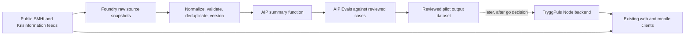

# TryggPuls + Palantir Foundry AIP: Opportunity Assessment

**Assessment date:** 2026-09-24  
**Recommendation:** Proceed with a bounded, non-production proof of value for source-backed alert summaries. Do not migrate TryggPuls to Foundry or add GPUs to production as part of this pilot.

## Executive decision

Foundry could add value if TryggPuls needs durable, governed history across many public sources and a repeatable model evaluation/deployment workflow. The current app already handles live feeds, route geometry, source freshness, and user-facing presentation in Node. Replacing those flows with Foundry would add integration and operating work before demonstrating a user benefit.

The best first experiment is to produce short Swedish summaries of public SMHI warnings and Krisinformation VMA/notices, keeping the agency's full original text and link visible. Run it offline against a human-reviewed test set. Test whether people understand what is happening, where it applies, and when it is valid more easily than with the current presentation. AIP Evals can hold test cases and compare function/model versions, but it is not a guarantee that every generated statement is correct; human review remains part of the proof of value. Pipeline Builder's current workspace announcement says evaluation suites for `Use LLM` nodes are generally available, which is a direct fit for this evaluation. [AIP Evals](https://www.palantir.com/docs/foundry/aip-evals/overview)

Use an AIP-hosted language model for the initial experiment. Your workspace's AIP model picker includes hosted models from OpenAI, Anthropic, Google, xAI, and NVIDIA, plus embedding and transcription models. The account is marked **AIP Tier Small**. The two vGPUs shown in Resource Management are unallocated, and your personal project's resource-queue panel says no GPU queue is assigned. Do not spend time on GPU inference until hosted-model evaluation shows a cost, latency, or privacy reason to do so. Foundry's trained-model pipeline sidecar defaults to no GPU; GPU allocation is configured for the project/pipeline and available types vary by environment. [Trained-model pipeline resources](https://www.palantir.com/docs/foundry/pipeline-builder/transforms-trained-model) · [GPU resource configuration](https://www.palantir.com/docs/foundry/transforms-python/configure-resources)

**Decision:** Go for the offline proof of value. Go/no-go for app integration only after alert quality, user comprehension, integration permissions, and enrollment cost are measured. No-go for predictive safety scores as a first release.

## What TryggPuls has today

The repo describes a public information product, not an operational incident prediction system. It integrates Police events, SMHI weather warnings and fire-risk forecasts, Krisinformation VMA/notices, Trafikverket disruptions when a key is configured, Police areas/stations, shelters, and BRÅ municipal statistics. See the endpoint and source descriptions in [`README.md`](../README.md).

The app already:

- Keeps public feeds separate, normalizes their records, caches them, and reports `fetchedAt`, `stale`, errors, and partial crisis-feed status. See [`feeds.mjs`](../feeds.mjs) and [`server.mjs`](../server.mjs).
- Matches routes with deterministic geometry and retains explicit caveats for approximate Police locations, source freshness, and the non-guarantee of safety. See [`route-analysis.mjs`](../route-analysis.mjs) and the route analysis in [`server.mjs`](../server.mjs).
- Has a PostgreSQL-backed family subsystem with account, shared-zone, and opted-in location features. Those records and precise locations are excluded from this assessment and pilot.
- Uses in-memory feed caches rather than a durable, versioned history of each public feed response. Foundry could make historical source-quality analysis easier, but data retention and a new ingestion pipeline would need to be built.

The app is deployed as a Node service on Render, with PostgreSQL configured separately in [`render.yaml`](../render.yaml). Foundry should be treated as an optional data/model service at first, not as a replacement for the existing backend.

## Findings from your Foundry workspace

I inspected the open workspace on 2026-09-24. These are account-specific observations, not assumptions based on Palantir's public product pages:

- Your personal project is empty. Its resource panel shows CPU jobs on the Default Queue and GPU jobs with **No queue assigned**.
- The existing personal project's access requirements show a **Viewer** default role and require a Shadow-Lancer organization membership; you also have an additional **Owner** role. It is empty, but it is not strictly private from other organization members.
- The new-project **Production project** template currently preselects three organization groups: Shadow-Lancer Users as Viewer, Builders as Editor, and Owners as Owner. The **Sandbox project** template says everyone can access and modify the project. Treat project template choice as an access decision, not just a naming step.
- Resource Management shows **2 unallocated vGPUs** at the enrollment and a Default Queue with **24 vCPUs**, all available at the time inspected. This confirms two virtual GPU slots are not currently assigned; it does not reveal physical GPU model, VRAM, or guarantee a project can use them without a queue assignment/administrator access.
- AIP usage & limits labels the enrollment **AIP Tier Small**. The hosted-model picker lists text/vision LLMs across several providers, controlled-schema models, embedding models, and transcription models. The reserved-capacity page for GPT-5.6 Sol showed no reserved allocation and displayed shared enrollment capacity of **4M tokens/minute and 800 requests/minute**. That is the shared capacity shown by this page, not a promise that each model has a dedicated reservation or that this pilot will consume it.
- The last-30-days Resource Management view showed AIP/model usage, led by Claude Sonnet 4.6. The display uses compute-seconds; it is not a cash-price estimate.
- The installed **AIP Now Ontology** is explicitly an airline-industry starter pack. Its Marketplace installation assets are locked for safe upgrades and the pipeline opened in read-only mode. Do not build the TryggPuls pilot inside that install.
- The starter pack includes a **Metrics and Alerts Pipeline** that derives period metrics, calculates changes, applies thresholds, and writes route-alert objects/comments, plus a **GeoJSON Extraction Pipeline** that parses and joins geospatial records. These are useful patterns for TryggPuls source-health alerts and official-zone geometry, but their sample objects/data describe aviation.
- Pipeline Builder displayed an announcement that LLM evaluation suites can evaluate `Use LLM` node outputs before deployment and write detailed run results to a Foundry dataset. This supports an offline summary benchmark without calling a model from the live TryggPuls request path.

**Practical implication:** use a dedicated editable project and public alert data only. The production template's current defaults grant organization groups Editor and Owner roles, while the sandbox template is organization-wide editable. Do not place nonpublic TryggPuls data in either setup. GPU work needs the unallocated vGPU capacity routed to a project queue; type and memory still need to be checked in an actual compute configuration.

## Foundry proof-of-value project created

On 2026-09-24, I created a dedicated Foundry project using the Production project template:

- **Project:** `TryggPuls AIP Proof of Value` — [open in Foundry](https://shadow-lancer.usw-16.palantirfoundry.com/workspace/compass/view/ri.compass.main.folder.3314feb7-e307-4bd7-9acd-f180e7d37c12)
- **Project RID:** `ri.compass.main.folder.3314feb7-e307-4bd7-9acd-f180e7d37c12`
- **Access inherited from template:** Shadow-Lancer Users (Viewer), Builders (Editor), Owners (Owner). Treat project artifacts and project-scoped evaluation results as visible to those groups.
- **AIP Logic:** `TryggPuls official alert summary` (RID `ri.eddie.main.logic.5a1b9f13-b91f-401d-9d18-d5c0ec0b2b0f`), with one required string input, `alertSourceRecord`. The saved draft uses Claude Sonnet 4.6 and returns `eventSummary: String`, `adviceGroups: Array<String>`, and `forecastDetails: String`. Timestamps and impact-only information are excluded from generated fields; source metadata can be carried over directly by a later pipeline.
- **AIP Evals:** `TryggPuls official alert summary - evaluation suite` (RID `ri.evals..evaluation-suite.bb8e3aae-4102-4326-9e02-7de19c79bdeb`) targets the Logic draft directly and has three configured LLM-as-a-judge evaluators for `eventSummary`, `adviceGroups`, and `forecastDetails`. The two public SMHI cases are a low-groundwater message and a gale warning.
- **Evaluation setup correction (2026-09-24):** an earlier run was invalid because the forecast expectations were accidentally assigned to the opposite alerts. I corrected them: groundwater expects an empty forecast field; the gale case expects its timed wind forecast. The corrected run at 22:11 local passed summary and advice checks for both records, and the gale forecast check. It failed only the groundwater forecast check: the model copied ongoing low-groundwater/low-flow conditions into `forecastDetails` despite explicit prompt instructions to leave it empty. The gale output retained its direction, speed, relative timing, and easing change, but remained bulletin-like (`Natt mot fredag nordväst 14–17 m/s. Fredag morgon avtagande.`). Foundry reported 8.95 compute-seconds for groundwater and 4.45 for gale, with 854/328 and 667/163 input/output tokens respectively; compute-seconds are not cash prices. This two-record smoke test is not a benchmark or user-comprehension study.
- **Expanded exploratory suite (2026-09-24):** the suite contains 17 public SMHI cases, including groundwater, gale, and forest-fire notices. The first full-speed attempt hit Claude Sonnet 4.6's project rate limit and judge parsing errors. I then set concurrency to one and changed all three judges to GPT-5.4 nano while leaving the summary function on Claude Sonnet 4.6. That run **completed all 17 cases**. The judges returned `0.176` for `eventSummary`, `0.176` for `adviceGroups`, and `0.000` for `forecastDetails` (3/17, 3/17, and 0/17). Treat these as exploratory judge outputs, not measured model quality: there is no human-reviewed reference set, and at least one apparently source-aligned Gotland summary was marked false while the gale forecast's fact-preserving shorthand was also marked false. The forecast field also copied ongoing groundwater conditions into summaries, confirming the known prompt failure. The run therefore supports a **no-go for app integration**, and the judge suite needs human-reviewed references and calibration before its scores can guide a decision.
- **Current preview behavior (2026-09-24):** the saved Logic draft preview for the Skåne record returned the event summary and three separate audience-specific advice entries as intended. It still populated `forecastDetails` with ongoing low-groundwater and low-flow conditions, despite the prompt's empty-field requirement. Keep all generated fields out of the live UI until this failure is fixed and valid evaluations pass.
- **Publish status:** publishing is blocked by Foundry validation with `Missing ontology binding for function`; the settings offered `Shadow-Lancer Ontology`. I left the function unpublished because this text-summary function has no ontology objects or edits to bind. AIP Evals can run against the draft directly, so this unrelated ontology binding is not needed for further offline evaluation.
- **Run history:** the project-scoped AIP Evals run-history dataset, `TryggPuls official alert summary - evaluation suite - run history` (RID `ri.foundry.main.dataset.87f62f02-fc1e-4abe-affa-d11ed5f3f2b2`), records the project-scoped runs. The suite displays the pass/fail metric and function output; the judge's optional reasoning is not currently useful for explaining failures.
- **Input dataset import:** the original empty dataset `TryggPuls public alert sample` (RID `ri.foundry.main.dataset.db2bd321-91d9-45cf-abd3-994d21e7e9f3`) and the separate [`TryggPuls public alert sample - imported`](https://shadow-lancer.usw-16.palantirfoundry.com/workspace/dataset/preview/ri.foundry.main.dataset.19eb74c7-0e3c-49cc-ba7f-41c5059c8281/master) (RID `ri.foundry.main.dataset.19eb74c7-0e3c-49cc-ba7f-41c5059c8281`) remain empty. I created a third, purpose-named empty dataset, [`TryggPuls SMHI public alerts 2026-09-24`](https://shadow-lancer.usw-16.palantirfoundry.com/workspace/dataset/preview/ri.foundry.main.dataset.79c1dc46-90d1-4867-b8ea-2233e4db72bc/master) (RID `ri.foundry.main.dataset.79c1dc46-90d1-4867-b8ea-2233e4db72bc`), in the pilot project. The local CSV is ready and contains 17 unique records with official SMHI URLs and no missing source IDs; all 17 rows in the review worksheet remain pending with blank human references. The upload dialog accepts CSV, but opening the local file chooser timed out. The upload workflow's Chrome troubleshooting requires `Allow access to file URLs` for the ChatGPT browser extension; I have not changed that security permission. No CSV has been uploaded yet. The 17 alert records are present directly in the saved Evals test cases. The local [`foundry-public-alert-sample.csv`](foundry-public-alert-sample.csv) contains the public SMHI records; Krisinformation endpoints returned no records at capture time. A separate [`foundry-review-queue.csv`](foundry-review-queue.csv) carries the same public records with blank human-reference fields and `review_status=pending`; it is a local review worksheet, not an approved Foundry output dataset.

- **Live UI re-check (2026-09-25):** the purpose-named SMHI dataset still shows an empty branch, and the upload dialog remains open. Foundry reports that the browser session has expired, so the user must sign in before further page work; I did not automate sign-in. The Logic draft still shows the `Missing ontology binding for function` publish error, and the latest visible groundwater preview again put current low-groundwater/low-flow conditions into `forecastDetails` despite the prompt's empty-field instruction. This confirms the existing no-go for user-facing generated text.
- **Access re-check (2026-09-28):** the Chrome Foundry tab is on Palantir's sign-in page. The local public SMHI sample still has 17 rows, and the review worksheet still needs human-approved references. No input import, new Evals run, publication, or production connection was made in the mobile redesign iteration.

**ChatGPT extension clarification:** no ChatGPT/Foundry connector is available in this task, and the open `ChatGPT - Chrome Web Store` tab is a browser-extension listing. A ChatGPT extension is not the integration path for the TryggPuls product. The supported architecture is a server-side Foundry API client in the existing Node backend, which reads the approved output dataset; no user route, family record, or precise location is sent. Foundry's current API exposes `GET /api/v2/datasets/{datasetRid}/readTable` with OAuth2 scope `api:datasets-read`. A non-interactive Render integration needs a registered confidential third-party application and a service user permissioned for only the approved output dataset. [Read Table Dataset](https://www.palantir.com/docs/foundry/api/datasets-v2-resources/datasets/read-table-dataset) · [Third-party application registration](https://www.palantir.com/docs/foundry/platform-security-third-party/register-3pa)

**What this confirms:** the tenant can create a dedicated project, run hosted AIP Logic previews, and retain project-scoped AIP Evals results. The completed 17-case run exposes a weak draft and an uncalibrated judge setup; generated text should not be served to TryggPuls users yet. A server-to-server connection is technically supported and the Node read-only adapter is prepared, but the input datasets are empty, no human-approved output dataset exists, and no external Node OAuth client is configured. Project registration creates a persistent client identity/secret and service-user access, so keep the app integration disabled until an approved output table and least-privilege access are ready. GPU queue assignment remains unknown.

## Opportunity map

Ratings are relative hypotheses from the repository and public product documentation. Compute/cost cannot be scored definitively without the user's enrollment and contract.

| Rank | Opportunity | User value | Current data fit | Delivery effort | Compute need | Main risk / decision |
| --- | --- | --- | --- | --- | --- | --- |
| 1 | Plain-language summaries of official warnings and VMA/notices, with source links and validity details | High | High | Medium | Low to medium; likely no GPU for a small text workload | Wrong paraphrase could distort urgent facts. Keep original text primary, evaluate offline, and fall back to original. Recommended pilot. |
| 2 | Historical feed quality and coverage dashboard: source uptime, stale periods, missing fields, duplicates, and publication-to-display delay | Medium for users; high for maintainers | Medium-high, but history must first be collected | Medium | Low | Durable history is absent today. Good Foundry fit if monitoring/analytics becomes an ongoing need; not an AI/GPU use case. |
| 3 | Cross-source deduplication and event linking for overlapping public alerts | Medium-high | Medium | Medium-high | Low to medium | Entity matching errors can hide distinct alerts. Needs a labeled set and clear provenance; consider after the summary pilot. |
| 4 | Search/Q&A over public guidance and current alerts | Potentially high | Medium | Medium-high | Low to medium for hosted LLM; a GPU is optional | A request tied to a person's route or location can disclose sensitive data. Keep location out of the first experiment; require source-grounded answers and an original-source link. |
| 5 | Crime/safety forecasting or route risk scores | Potentially high but unproven | Low | High | Unknown; GPU does not fix poor data | Police reports can be delayed and geographically approximate, while BRÅ statistics are periodic municipal aggregates. False precision or biased interpretation could mislead. Do not pursue as a first feature. |

The workspace makes an additional internal use case concrete: adapt the Metrics and Alerts pattern to track source health over time (stale duration, feed failures, partial responses, and missing required fields). This is a strong low-risk second pilot if the goal shifts from end-user comprehension to operations. It does not require an LLM or GPU, but it does require scheduled ingestion because the current Node feed caches are in-memory only.

Foundry is strongest where TryggPuls needs to combine data from more sources, keep lineage/version history, and govern model evaluation and release. Palantir documents model integration from in-platform or external sources and model management/deployment workflows. [Model connectivity and development](https://www.palantir.com/docs/foundry/model-integration/overview)

It is not a compelling reason by itself to move today's route calculations: the repo already performs spatial matching deterministically, while the main missing capability is retained historical data, not GPU throughput.

## Recommended proof of value

### Question to answer

Do source-backed, plain-language summaries help people understand official SMHI and Krisinformation alerts more accurately and quickly than the current display, without losing or changing critical facts?

### Corpus and workflow

1. Build a bounded evaluation corpus of approximately 100 public alert records from SMHI and Krisinformation. Include normal cases and edge cases: partial feed failures, stale snapshots, missing/ambiguous validity or area fields, long descriptions, and changed source content. Use public records only; do not include user queries, family data, exact routes, or account data.
2. Preserve each source record and its original URL. Normalize source name, stable source ID, publication/update time, source fetch time, title, source text/advice, area, severity, and validity interval when provided. Missing fields remain missing; the model must not infer them.
3. Create a reference set of human-reviewed summaries or expected key facts. Generate Swedish summaries with a constrained function, then evaluate completeness, supported claims, preservation of dates/areas/severity/advice, and consistency across repeated runs. The Logic model selector currently shows Claude Sonnet 4.6 and its 1M-context variant; other model availability in this enrollment is unverified. Use the model catalog to confirm alternatives and compare cost only when they are available. AIP Evals supports test cases, custom evaluation functions, model comparisons, and repeated-run variance checks. [AIP Evals overview](https://www.palantir.com/docs/foundry/aip-evals/overview)
4. Run a small, controlled comprehension comparison against the existing source presentation. Ask readers to identify what happened, where, when, and the cited source. Track task accuracy and time; retain the current UI as the baseline.
5. Report quality, user results, end-to-end latency, per-record/token usage, estimated monthly cost at observed volumes, required Foundry setup, and any operational work needed to keep outputs fresh.

### Proposed output contract for a later app connection

Keep this contract in the design until the offline proof passes; do not add an endpoint as part of the assessment itself.

```json
{
  "sourceId": "agency-record-id",
  "contentVersion": "hash-or-source-version",
  "summarySv": "Short, source-grounded summary.",
  "sourceUrl": "https://official-source.example/item",
  "sourceUpdatedAt": "2026-09-24T10:00:00Z",
  "sourceFetchedAt": "2026-09-24T10:01:00Z",
  "generatedAt": "2026-09-24T10:02:00Z",
  "modelVersion": "model-and-version",
  "reviewStatus": "approved"
}
```

Use the agency ID plus a hash/version of the source content so an update cannot accidentally display a summary of the previous version. Missing, stale, unreviewed, or version-mismatched summaries are not served; the current original agency content remains available. The summary supplements and never replaces the official text, severity, area, validity, or advice.

## Technical prototype design

### Data flow



For the first prototype, keep the Foundry outputs in the evaluation/review environment; do not serve generated content to production users. For a later controlled UI test, publish only reviewed records and let the existing Node backend fetch them server-to-server. Palantir documents external REST APIs for application integration and OAuth 2.0 for Foundry APIs. Exact auth, API scopes, outbound network rules, and dataset/Ontology query path must be checked in the actual enrollment. [Foundry REST API options](https://www.palantir.com/docs/foundry/available-connectors/rest-apis) · [Direct model deployments](https://www.palantir.com/docs/foundry/manage-models/create-a-model-deployment)

### Prepared app-side connection

The Node backend now has a disabled-by-default read-only Foundry adapter in `foundry-summaries.mjs` and an optional `/api/alert-summaries` endpoint. The endpoint queries the live SMHI feed on the server, then returns only records from a separately configured Foundry summary-output dataset when all of these checks pass: `reviewStatus=approved`, official SMHI/Krisinformation source URL, a matching SHA-256 source version, and recent source/generation timestamps. If Foundry is disabled, unavailable, stale, or mismatched, the endpoint returns no generated text; the existing alert endpoints remain unchanged. No browser/mobile code sends data to Foundry. The route is not wired into the UI and `FOUNDRY_SUMMARIES_ENABLED` defaults to false.

The source-version hash is SHA-256 over a compact JSON array of the following strings, in this exact order: `sourceId`, `title`, `area`, `level`, `levelLabel`, `publishedAt`, `validFrom`, `validTo`, `sourceUrl`, `sourceText`. The Foundry transform and the Node adapter must use the same field order and exact text; otherwise the summary is suppressed. The pilot input dataset is not a valid output dataset: configure `FOUNDRY_SUMMARIES_DATASET_RID` only after creating a distinct table with the summary contract above.

Runtime configuration is represented by `FOUNDRY_BASE_URL`, `FOUNDRY_CLIENT_ID`, `FOUNDRY_CLIENT_SECRET`, `FOUNDRY_SUMMARIES_DATASET_RID`, `FOUNDRY_SUMMARIES_BRANCH`, `FOUNDRY_SUMMARIES_ENABLED`, and `FOUNDRY_SUMMARIES_MAX_AGE_MS`. The expected production application is a confidential client using the OAuth client-credentials grant and a service user restricted to read the approved output dataset. Keep the secret only in Render's server-side environment; do not commit it or send it in chat. The adapter requests only the `api:datasets-read` operation scope. [Palantir authentication](https://www.palantir.com/docs/foundry/api/general/overview/authentication) · [Read Table Dataset](https://www.palantir.com/docs/foundry/api/v2/datasets-v2-resources/datasets/read-table-dataset) · [Registering third-party applications](https://www.palantir.com/docs/foundry/platform-security-third-party/register-3pa)

**Current connection status:** this is connectable, but it is **not connected**. The local Node server has a disabled-by-default, read-only adapter for Foundry `readTable` using the `api:datasets-read` scope; no ChatGPT extension is required for the TryggPuls API integration. The Foundry input datasets are empty, no human-approved output table exists, and no OAuth client/service user or Render secret has been configured. A one-time public-data import and reviewed output table come first. Then an administrator can register a confidential OAuth client and grant its service user read access only to that table; the resulting secret belongs in Render's server-side secrets. I have not created the persistent credential or widened access. [OAuth authentication](https://www.palantir.com/docs/foundry/api/general/overview/authentication) · [Read Table Dataset](https://www.palantir.com/docs/foundry/api/datasets-v2-resources/datasets/read-table-dataset)

### Sending the public pilot data into Foundry

Foundry supports uploading a file into an existing dataset using `POST /api/v2/datasets/{datasetRid}/files/{filePath}/upload`; OAuth third-party clients need the `api:datasets-write` scope and write permission on that dataset. A recurring ingestion can instead use a configured Foundry Data Connection to sync an external REST API or database. [Upload File API](https://www.palantir.com/docs/foundry/api/datasets-v2-resources/files/upload-file) · [Data Connection setup](https://www.palantir.com/docs/foundry/data-connection/initial-setup-overview)

There is **no outbound Foundry uploader in the TryggPuls app yet**. For this pilot, first upload only the prepared public SMHI alert sample to a dedicated input dataset, then generate and human-review summaries in Foundry. Keep any write credential separate from the app's read-only production credential. Do not give a web or mobile client Foundry credentials, and do not upload family data, exact GPS positions, or per-user route requests. A production push job should be added only after the dataset schema, retention, write identity, and review process are agreed.

### Function behavior and safeguards

- Input: only the public source record and source metadata needed to summarize it.
- Output: concise Swedish text, with no new claims, inferences about danger, personalized route advice, or invented missing dates/areas. Keep direct quotations minimal and do not copy large portions of source text.
- Error or unavailable model: no summary; retain and show the original source item.
- Out-of-date source: do not serve a summary unless its `contentVersion` matches the latest source version.
- UI during a later pilot: label the text as an AI-generated summary, show source and updated/valid-through metadata, and keep the original official text one interaction away or directly visible.
- Credentials: store Foundry credentials only in Render server-side secrets; never expose them to browser/mobile clients. Use least-privilege read access to the approved output, and do not send per-user route requests to Foundry.
- Latency: generate summaries asynchronously on source changes or a controlled schedule, not in the user's request path. Failure or delay must not block live agency alerts.

### Why not start on the GPUs?

The first question is whether the summary improves comprehension, not whether inference can be accelerated. AIP-hosted LLM usage and project GPU transforms are distinct resource paths. Foundry documentation says trained-model pipeline sidecars default to one CPU core, 8 GB memory, and no GPU; it also lists several GPU types but notes types must be provisioned for the project and are not available in every environment. Model startup, pipeline parallelism, and continuously allocated streaming resources affect cost. [Trained-model resource and cost behavior](https://www.palantir.com/docs/foundry/pipeline-builder/transforms-trained-model) · [GPU provisioning](https://www.palantir.com/docs/foundry/transforms-python/configure-resources)

Therefore:

- First benchmark an available AIP-hosted model on the small corpus and inspect AIP token/compute usage.
- Only benchmark a GPU-hosted open model if hosted model cost, latency, deployment restrictions, or data-residency requirements make it a plausible alternative.
- Record GPU type, memory, model size/quantization, throughput, startup time, and utilization from the enrollment; do not infer these from “2 GPUs.”
- Confirm contract pricing with the enrollment owner/Palantir contact. Public docs state that listed default AIP usage rates do not apply to every customer. [AIP compute usage](https://www.palantir.com/docs/foundry/aip/aip-compute-usage)

## Go/no-go checklist

Proceed to a controlled app integration only if all are true:

- **Factual fidelity:** Human review finds no critical unsupported or altered fact in the evaluation set, especially severity, place, time, validity, or official advice. Any critical error blocks rollout until the function/prompt/model is changed and reevaluated.
- **User comprehension:** In the comparison, readers answer the what/where/when/source questions at least as accurately as with the current presentation, and the summary produces a measurable improvement in completion time or comprehension. Record the baseline and confidence/limitations rather than claiming broad population impact from a small study.
- **Source freshness:** Version mismatch, stale source, missing metadata, and Foundry outage all suppress generated text and preserve the existing official feed behavior.
- **Operational feasibility:** A secure server-to-server API path from Render to Foundry is permitted; no secret reaches clients; Foundry latency does not delay the app's current feeds.
- **Cost:** Cost per generated record and monthly expected volume are visible in the enrollment's real usage data and fit an agreed budget. Public tariff examples are not treated as the user's price.
- **Data governance:** The pilot uses public source records only and does not ingest family accounts, exact device locations, route endpoints, personal zones, or chat content.

If quality passes but user comprehension does not improve, stop the user-facing pilot and consider Foundry only for source-history/quality monitoring if that solves a separately stated operational need. If integration or model cost cannot be confirmed, keep results inside Foundry and do not connect it to Render.

## Enrollment-specific questions to verify before prototype setup

These details cannot be established from the repo or Palantir's public docs and should be read from the actual Foundry enrollment/contract:

1. Which AIP model providers/models and AIP Evals features are enabled, and what usage is included or billed?
2. What are the two GPU models, VRAM, project quota/concurrency, and per-job costs? Which environment/region can use them?
3. Are Python transforms, AIP Logic, model deployment, and the required REST API/OAuth client-credential scopes enabled for this project?
4. Can the Foundry project fetch the public SMHI/Krisinformation endpoints, and can the Render service reach the Foundry API over approved egress?
5. What retention, region, and human approval requirements apply to public-source snapshots and generated summaries?

The workspace confirms two unallocated vGPUs and shows a hosted-model catalog; GPU type, VRAM, project queue assignment rights, model-specific limits, and cash cost remain unknown. Palantir's AIP documentation also notes feature availability may differ between customers. [AIP overview](https://www.palantir.com/docs/foundry/aip)

## References

- TryggPuls product and endpoint behavior: [`README.md`](../README.md), [`feeds.mjs`](../feeds.mjs), [`route-analysis.mjs`](../route-analysis.mjs), [`server.mjs`](../server.mjs), [`render.yaml`](../render.yaml).
- Palantir, [AIP overview](https://www.palantir.com/docs/foundry/aip).
- Palantir, [Model connectivity and development](https://www.palantir.com/docs/foundry/model-integration/overview).
- Palantir, [AIP Evals overview](https://www.palantir.com/docs/foundry/aip-evals/overview).
- Palantir, [Trained model node](https://www.palantir.com/docs/foundry/pipeline-builder/transforms-trained-model), [GPU resource configuration](https://www.palantir.com/docs/foundry/transforms-python/configure-resources), and [AIP compute usage](https://www.palantir.com/docs/foundry/aip/aip-compute-usage).
- Palantir, [REST APIs](https://www.palantir.com/docs/foundry/available-connectors/rest-apis) and [direct model deployments](https://www.palantir.com/docs/foundry/manage-models/create-a-model-deployment).
