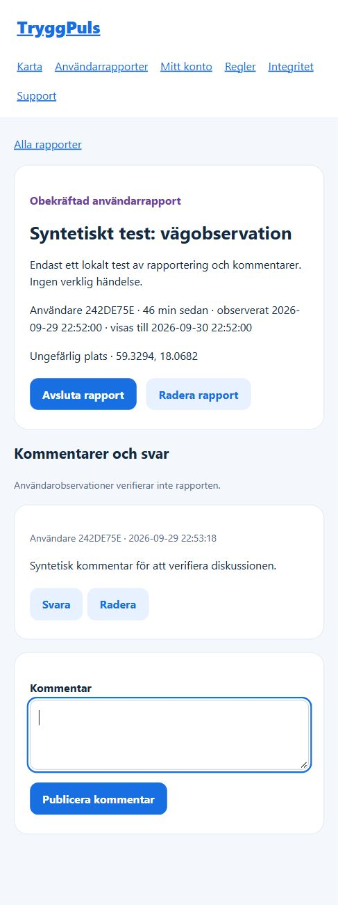

# Local release checks — 29 September 2026

The implementation is available in the working tree. It has not been deployed, signed, submitted to either store, or enabled for public production reporting.

## Completed checks

| Check | Result |
|---|---|
| Backend tests | 114 tests: 112 passed, 0 failed, 2 skipped because a dedicated PostgreSQL test server was unavailable |
| Mobile state tests | 12 passed |
| Feed store tests | 4 passed, including retaining successful data during failures and removing expired reports while offline |
| JavaScript syntax | 40 modules passed |
| Mobile TypeScript | Passed |
| Expo dependency compatibility | Up to date; Expo Doctor 21/21 checks passed |
| iOS and Android JavaScript bundle exports | Both passed after the final navigation and map layout changes |
| Dependency audits | No reported vulnerabilities in either root or mobile dependencies, including development dependencies |
| Render Blueprint schema | Validated against the official schema |
| Tracked diff whitespace | `git diff --check` passed |

The backend checks include public-coordinate/account-field privacy, eligibility and staff permissions, durable rate limits, duplicate submissions, blocking, expiry, photo review/access and metadata removal, cleanup, and notification retry behavior. Their test fixtures do not establish delivery through live providers.

Local execution used Node.js 22.18.0. Deployment and CI are configured for Node.js 24; the remote CI workflow has not been run here. PostgreSQL concurrency tests and the backup/restore rehearsal are prepared but were not executed locally. The local database-backed checks use the isolated test database implementation.

## Browser check

An isolated local server with synthetic accounts and content was used to check sign-in, report location preview and server acceptance, comments, the new-updates control, and restoring report/comment drafts after a reload. Live email, object storage, monitoring, and push integrations were disabled for this check. The server was stopped and the browser tab closed afterwards.

This is a web verification image, not an installed Expo screen or a store screenshot. The sketch-led phone layout has since been superseded by the [exact prototype restoration](prototype-restoration.md); its native rendering and gestures still need installed-device comparisons.

## Outstanding release evidence

- Install signed preview builds on iPhone and Android. Compare the restored prototype screens at small widths and large text; exercise maps, navigation, keyboard, native date/time selection, photos, carousel pauses, and VoiceOver/TalkBack.
- Demonstrate report creation, replies, blocking, moderation removal, resolution, and expiry between two devices within a refresh cycle. Exercise offline and lost-response retries and logout during requests.
- Run the PostgreSQL concurrency checks and restore/rollback rehearsal against a dedicated disposable PostgreSQL server, and test recovery of private image objects with their database review states.
- Configure and exercise the owner's actual S3, verified email domain, monitoring, map credentials, universal links, signing, and opt-in native notifications.
- Complete operator policies, store disclosures, installed-app screenshots, reviewer access, moderation staffing, and owner release approval. Keep production publishing disabled until acceptance is recorded.

Configuration and rollout instructions are in [the mobile release guide](../mobile-release.md).
